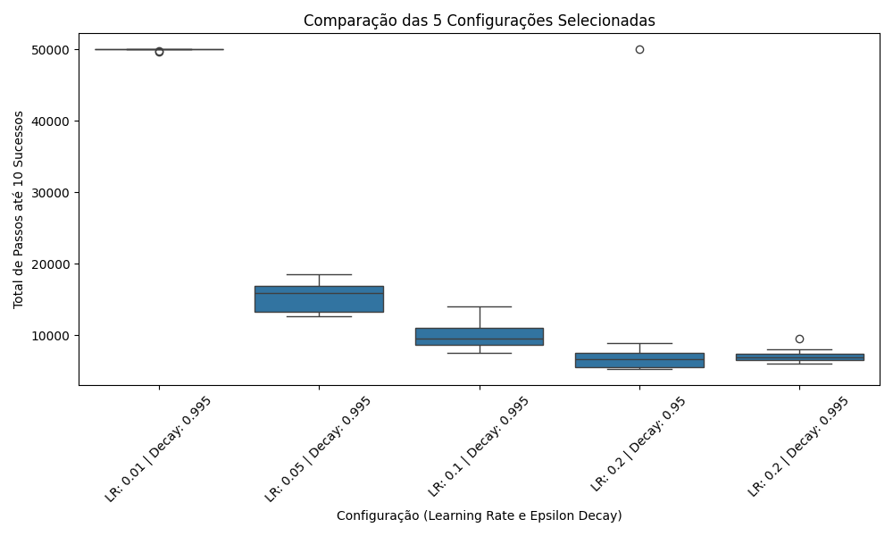

# Relatório Experimental: Ajuste de Hiperparâmetros no Ambiente Mountain Car

## 1. Descrição do Setup Experimental

O objetivo deste experimento foi avaliar a convergência, a estabilidade e a velocidade de aprendizado de um agente por Reforço no ambiente clássico **Mountain Car**, utilizando aproximação linear de funções de valor com bases radiais (RBF). 

### 1.1 Configurações e Parâmetros
* **Ambiente:** `MountainCar-v0`
* **Critério de Parada:** O treinamento é interrompido com sucesso assim que o agente alcança **10 episódios bem-sucedidos** (atingindo o topo da montanha).
* **Teto Máximo de Passos (`MAX_STEPS`):** Fixado em **50.000 passos**. Caso o agente esgote esse limite sem atingir a meta, a execução é encerrada e rotulada como falha de convergência.
* **Repetições:** Cada configuração foi executada ao longo de **10 sementes aleatórias (*seeds*)** independentes para garantir significância estatística e mitigar o ruído estocástico do ambiente.

### 1.2 Espaço de Hiperparâmetros
Durante a fase exploratória, avaliou-se um grid de hiperparâmetros combinando diferentes taxas de aprendizagem ($\alpha$) e fatores de decaimento de exploração ($\epsilon\text{-decay}$):
* **Taxas de Aprendizagem ($\alpha$):** $\{0.01, 0.05, 0.1, 0.2\}$
* **Fatores de Decaimento ($\epsilon\text{-decay}$):** $\{0.95, 0.99, 0.995\}$

---

## 2. Boxplot e Interpretação dos Resultados

A partir do grid experimental completo, foram selecionadas **5 configurações representativas** para análise comparativa aprofundada:
1. `LR: 0.01 | Decay: 0.995`
2. `LR: 0.05 | Decay: 0.995`
3. `LR: 0.1  | Decay: 0.995`
4. `LR: 0.2  | Decay: 0.95`
5. `LR: 0.2  | Decay: 0.995`

### 2.1 Justificativa da Seleção das 5 Configurações
A escolha dessas configurações baseou-se no isolamento controlado de variáveis para evidenciar os dois principais fenômenos teóricos do aprendizado por reforço:
* **Efeito isolado de $\alpha$ (Isolamento da Taxa):** Ao fixar o decaimento em $0.995$ e variar $\alpha \in \{0.01, 0.05, 0.1, 0.2\}$, mapeia-se a curva de transição: desde a subaprendizagem severa até a convergência de alto rendimento.
* **Efeito isolado do $\epsilon\text{-decay}$ em regime de alto $\alpha$:** Ao comparar `(0.2, 0.95)` com `(0.2, 0.995)`, expõe-se o risco de reduzir a exploração prematuramente quando as atualizações de peso são agressivas.

### 2.2 Tendências Observadas e Discussão

| Configuração | Mediana Aprox. (Passos) | Dispersão / Variância | Comportamento Observado |
| :--- | :--- | :--- | :--- |
| **`LR: 0.01 \| Decay: 0.995`** | ~50.000 | Nula (colada no teto) | **Subaprendizagem:** Passos de atualização pequenos demais; não aprende dentro do tempo hábil. |
| **`LR: 0.05 \| Decay: 0.995`** | ~15.000 | Moderada | **Convergência Estável:** 100% de convergência sem falhas, porém com ritmo mais lento. |
| **`LR: 0.1 \| Decay: 0.995`** | ~9.500 | Baixa | **Aceleração Consistente:** Ganho expressivo de velocidade sem perda de estabilidade. |
| **`LR: 0.2 \| Decay: 0.95`** | ~6.000 | Média (*Outlier* em 50.000) | **Alta Velocidade com Risco:** Menor tempo mediano, mas vulnerável à convergência prematura (*subótima*). |
| **`LR: 0.2 \| Decay: 0.995`** | ~7.000 | Muito Baixa | **Ótimo Robusto:** Rápido e consistente; a exploração prolongada absorveu a agressividade do $\alpha$. |

### 2.3 Hipóteses Validadas
1. **Hipótese de Subaprendizagem ($\alpha = 0.01$):** Confirmou-se que taxas excessivamente baixas impedem a propagação das recompensas atrasadas (*sparse rewards*) ao longo do espaço contínuo antes de atingir o limite de $50.000$ passos.
2. **Hipótese de Exploração Prematura vs. Passos Grandes ($\alpha = 0.2, \text{Decay} = 0.95$):** Um decaimento rápido força o agente a se tornar *greedy* muito cedo. Quando combinado com um $\alpha$ alto, oscilações iniciais nos pesos levam a políticas subótimas fixas, resultando em falha catastrófica pontual (outlier em 50.000 passos).
3. **Hipótese de Compensação pela Exploração ($\alpha = 0.2, \text{Decay} = 0.995$):** Manter uma taxa de exploração mais alta por mais tempo permite ao agente corrigir perturbações decorrentes de passos grandes, alcançando a melhor relação de velocidade e estabilidade.

---

## 3. Conclusão

Os resultados evidenciam que o sucesso do agente no Mountain Car não depende unicamente de aumentar a taxa de aprendizagem para acelerar o processo, mas sim do equilíbrio dinâmico entre a magnitude do ajuste de pesos ($\alpha$) e o ritmo de cessação da exploração ($\epsilon\text{-decay}$).

Enquanto valores conservadores ($\alpha = 0.05$) garantem segurança à custa de lentidão, taxas mais agressivas ($\alpha = 0.2$) entregam o melhor desempenho prático, desde que acompanhadas por um decaimento lento ($\epsilon\text{-decay} = 0.995$). Dessa forma, a melhor configuração obtida para o problema foi **$\alpha = 0.2$ com $\epsilon\text{-decay} = 0.995$**, que minimizou o número de passos até o critério de sucesso mantendo variância mínima e taxa nula de falhas.